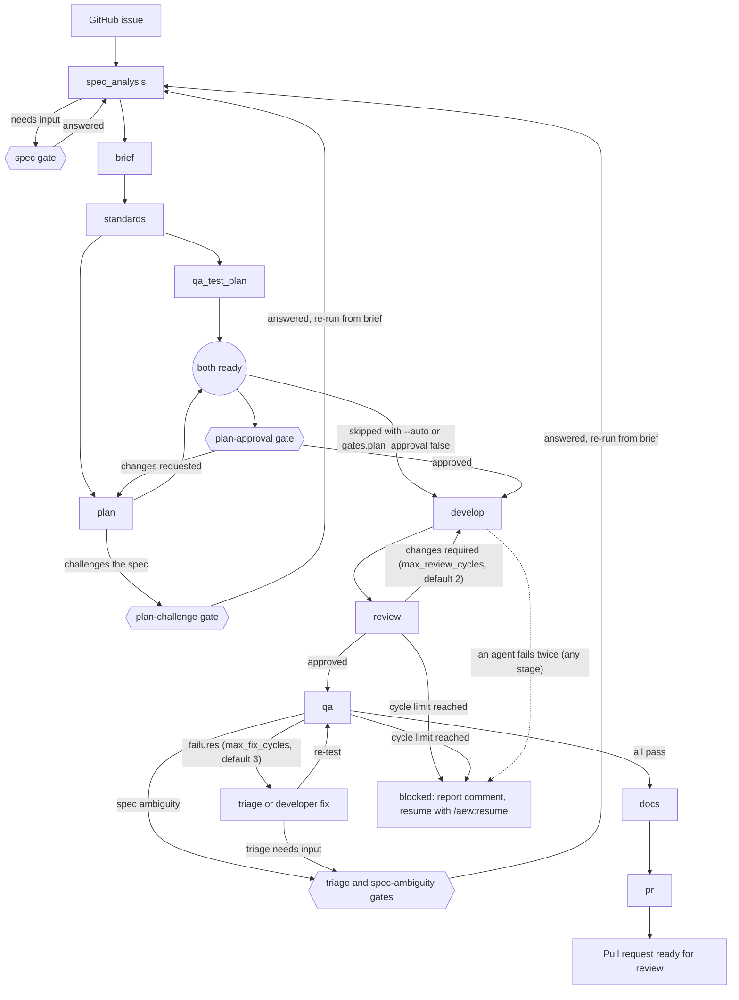

# aew

A personal Claude Code plugin that delivers GitHub issues end to end through a spec-driven,
multi-agent pipeline. Each issue is treated as a spec. The pipeline runs: analyse the spec →
compile a brief → set standards → plan → build → review → test (including UI) → document →
open a PR ready for review.

**Status: in development.** The design is in [`docs/DESIGN.md`](docs/DESIGN.md) and the build
order is in [`docs/build-prompts/`](docs/build-prompts/00-README.md).

## Install

This repo is both the plugin and a personal marketplace, `jamesborg-plugins`.

```bash
claude plugin marketplace add /path/to/claude-agentic-engineer-workflow
claude plugin install aew@jamesborg-plugins
```

To try it for one session without installing it, run `claude --plugin-dir .` from the repo. The
dependencies below must already be installed, because a `--plugin-dir` session doesn't install them.

## Prerequisites

git, gh (authenticated), jq, Node 20 or later, plus stack tools as needed (php/composer, dotnet,
Docker for wp-env or ddev).

## Dependencies

Declared in `.claude-plugin/plugin.json`, all from the official `claude-plugins-official` marketplace:

| Plugin | Used for |
|---|---|
| `superpowers` | TDD, debugging and verification skills preloaded into specific agents |
| `context7` | Current library and framework docs |
| `frontend-design` | UI work packages |

**Cross-marketplace config.** Claude Code won't install a dependency from a different marketplace
unless the root marketplace allows it. `.claude-plugin/marketplace.json` therefore sets
`"allowCrossMarketplaceDependenciesOn": ["claude-plugins-official"]`. Without it, the install
completes without the dependencies and `aew` fails to load. If `claude-plugins-official` isn't
in `claude plugin marketplace list`, add it with
`claude plugin marketplace add anthropics/claude-plugins-official`.

**Why superpowers has no version range.** A version range resolves only against git tags named
`superpowers--v<version>`. The superpowers repo tags releases as `v<version>`, so a range such as
`^7.0.0` would make the install fail. The official marketplace pins superpowers to a commit
(v7.0.0 when this was written), so the dependency moves only when that pin does. `aew` is built
against superpowers 7.x.

**Installing the dependencies by hand.** Do this when using `--plugin-dir`, or if the install
skipped them:

```bash
claude plugin install superpowers@claude-plugins-official
claude plugin install context7@claude-plugins-official
claude plugin install frontend-design@claude-plugins-official
```

A copy of superpowers from another marketplace, such as `anthropic-plugin-directory`, doesn't
satisfy `superpowers@claude-plugins-official`. The CLI treats it as the same plugin and installs
nothing, so switch it over with
`claude plugin install superpowers@claude-plugins-official --replace`.

## Commands

Run each command inside Claude Code, from the root of the target project. The plugin's skills are
namespaced `/aew:<skill>`.

| Command | Purpose |
|---|---|
| [`/aew:init`](#aewinit) | Set a project up for aew |
| [`/aew:ship <issue>`](#aewship) | Deliver one issue as a pull request |
| [`/aew:resume [<run-id>]`](#aewresume) | Continue an interrupted run |
| [`/aew:status [<run-id>]`](#aewstatus) | Show the runs in the project |
| [`/aew:prompt <issue>`](#aewprompt) | Turn an issue into one self-contained prompt |

`/aew:ship-milestone` (one run per milestone) is coming in a later release. Until then `ship` and `resume`
refuse a milestone id (`m-<n>`) with a message saying so.

### Pipeline



The planning pair (`qa_test_plan` and `plan`) runs in parallel. The hexagons are the points where
the run can stop and ask you a question. The full state machine, with every status and failure
path, is in [`skills/run-protocol/references/state-machine.md`](skills/run-protocol/references/state-machine.md).

### /aew:init

Syntax: `/aew:init`

```text
/aew:init
```

Prepares the current project on a `chore/aew-init` branch and opens a pull request. It checks the
prerequisites and a clean working tree, adds the gitignore lines, detects the stacks and writes
`.aew/config.json`, ensures the GitHub labels, offers Playwright setup for UI projects, adds an
aew section to `CLAUDE.md`, proposes permissions, generates the first standards documents and
pushes. It is safe to re-run: it only adds what is missing and keeps values already in your config.

Where it asks:

- **Inferred config values**, in one round. Values already in your config are kept, not re-asked.
- **Playwright and axe**, only when it finds a UI project without `@playwright/test`.
- **Permissions**, once. It shows the rules, then asks whether to write them. The portable rules go
  to `.claude/settings.json`, which is committed in the init pull request. The rules naming the
  plugin's scripts by absolute path go to `.claude/settings.local.json`, which is gitignored so your
  machine's path never reaches other cloners. To undo them, don't merge the init pull request (or
  delete the added entries from `.claude/settings.json`), and delete the added entries from
  `.claude/settings.local.json`.

In a headless run, or with no answer, it takes the safe defaults: the recommended config values, no
installs and no settings file written.

### /aew:ship

Syntax: `/aew:ship <issue> [--auto] [--from <stage>]`

```text
/aew:ship 42
/aew:ship 42 --auto
/aew:ship 42 --from plan
```

Takes issue `<issue>` through the whole pipeline in the diagram above, on a branch named from the
issue, and ends with a pull request ready for review. State lives in `.aew/runs/<issue>/`, which is
gitignored. Preflight fails fast if the config is missing, the tree is dirty, `gh` is not
authenticated, the default branch is behind or has diverged from `origin`, or another run is active.

- `--auto` skips the plan-approval gate. The other gates still ask.
- `--from <stage>` restarts a run at one of `spec_analysis`, `brief`, `standards`, `qa_test_plan`,
  `plan`, `develop`, `review`, `qa`, `docs` or `pr`. Earlier stages are not redone, and a finished
  run's pull request is updated rather than re-created.

Gates, each a question put to you in the main session:

| Gate | Asks when | Skipped by `--auto` |
|---|---|---|
| `spec` | The spec analyser needs answers before it can continue | No |
| `plan-challenge` | The planner challenges the spec | No |
| `triage` | QA triage needs a decision about where a failure started | No |
| `spec-ambiguity` | QA finds the spec ambiguous about intended behaviour | No |
| `plan-approval` | The plan is ready: approve it, request changes or stop | Yes (also off when `gates.plan_approval` is `false` in the config) |

Each question lists the recommended answer first. If a gate cannot be asked, for example in a
headless run, the run stays pending and prints how to answer it with `/aew:resume`. When the spec is
revised, the issue body shows the new version on top, earlier versions are kept below it and a
comment lists the changes.

### /aew:resume

Syntax: `/aew:resume [<run-id>]`

```text
/aew:resume
/aew:resume 42
```

Continues an interrupted or blocked run. With no argument it uses the current run. It re-asks a
pending gate, or re-enters `ship` at the recorded stage after checking the config, `gh`, the working
tree and the branch. It never re-runs an earlier stage. A finished run is reported, not restarted:
a `failed` run points you to `/aew:ship <issue> --from <stage>`. It asks only what the pending gate
asks.

### /aew:status

Syntax: `/aew:status [<run-id>]`

```text
/aew:status
/aew:status 42
```

Read-only. With no argument it lists every run with its status, stage, last update, whether it is
current and its title. With a run id it shows that run's state, the last 10 log lines, the review
and fix cycles used against their limits, the pending gate if any, and the next action to take. It
asks nothing and writes nothing.

### /aew:prompt

Syntax: `/aew:prompt <issue>`

```text
/aew:prompt 42
```

Writes one self-contained prompt, `.aew/runs/<issue>/prompt.md`, for a plain Claude Code session.
It runs spec analysis with the same material-change gate as `ship`, then the brief compiler in
prompt mode. It creates no branch, makes no commit and sets no stage labels. The `spec` gate can ask
you questions; at the end it offers to post `prompt.md` as a comment on the issue, and does nothing
if you decline. To build the issue with aew instead, run `/aew:ship <issue> --from spec_analysis`.

## Config reference

`.aew/config.json` in the target project. Schema: [`templates/config.schema.json`](templates/config.schema.json).
Example: [`templates/config.example.json`](templates/config.example.json).

_Field reference to be written._

## Labels

_To be written._

## Troubleshooting

- **`Dependency "superpowers@claude-plugins-official" is not installed`:** install the dependencies
  (see above), then run `/reload-plugins`.

## Uninstall

_To be written._
