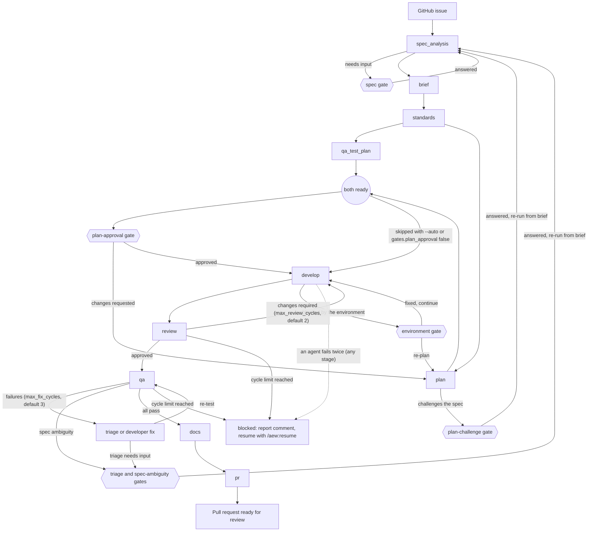

# aew

A personal Claude Code plugin that delivers GitHub issues end to end through a spec-driven,
multi-agent pipeline. Each issue is treated as a spec. The pipeline runs: analyse the spec →
compile a brief → set standards → plan → build → review → test (including UI) → document →
open a PR ready for review.

Validated end to end on real GitHub before 0.1.0: init, single-issue runs with and without gates,
a UI run with Playwright and axe, spec and manual-test rewrites of real issues, bulk and sequential
milestones, an interrupted run resumed, and prompt mode. The record is
[`tests/e2e-validation.md`](tests/e2e-validation.md); the design is [`docs/DESIGN.md`](docs/DESIGN.md).

## Install

This repo is both the plugin and a personal marketplace, `jamesborg-plugins`. Install a release from
GitHub, pinned to its tag:

```bash
claude plugin marketplace add jamesborg2012/claude-agentic-engineer-workflow#aew--v0.1.0
claude plugin install aew@jamesborg-plugins --scope user
```

`#aew--v0.1.0` pins the marketplace to that release tag. Claude Code copies aew into its plugin cache
(`claude plugin list --json` shows `installPath` `~/.claude/plugins/cache/jamesborg-plugins/aew/0.1.0`), so
every project runs the released version. The repo is private: the clone uses the git credentials already on
your machine (an SSH key that GitHub accepts, otherwise HTTPS with your `gh auth login` credentials) and never
prompts.

The install pulls in the three dependencies below. On a machine where Claude Code has never run an
interactive session, `claude-plugins-official` isn't registered yet, and the install warns
`dependency "superpowers@claude-plugins-official" was not installed (no marketplace you have added
lists it)`. Add it first with `claude plugin marketplace add anthropics/claude-plugins-official`,
then uninstall and install aew again.

**Check the dependencies installed.** To see the install pull them in from a clean state without
touching your own config, use a throwaway config directory:

```bash
export CLAUDE_CONFIG_DIR="$(mktemp -d)"
claude plugin marketplace add anthropics/claude-plugins-official
claude plugin marketplace add jamesborg2012/claude-agentic-engineer-workflow#aew--v0.1.0
claude plugin install aew@jamesborg-plugins --scope user   # "(+ 3 dependencies: superpowers, context7, frontend-design)"
claude plugin list --json | jq -r '.[].id'                 # aew, context7, frontend-design, superpowers
unset CLAUDE_CONFIG_DIR
```

**Upgrade to a new release.** A pinned marketplace keeps its tag, so add it again with the new one (removing
the marketplace also uninstalls aew; its dependencies stay):

```bash
claude plugin marketplace remove jamesborg-plugins
claude plugin marketplace add jamesborg2012/claude-agentic-engineer-workflow#aew--v<new version>
claude plugin install aew@jamesborg-plugins --scope user
```

The cached path includes the version, so re-run `/aew:init` in each project afterwards and accept the
permission rules: its `.claude/settings.local.json` names the plugin's scripts and folder by that path, and
headless runs need the new one. Init adds the new rules and keeps the old, harmless ones.

**Every release bumps `version`.** Updates are keyed on `version` in `.claude-plugin/plugin.json`: a release
that keeps the old version is never picked up by an installed copy (`claude plugin update` reports it is
already at the latest version).

**Working on aew itself.** Install from your checkout instead, with
`claude plugin marketplace add /path/to/claude-agentic-engineer-workflow`. A relative-path plugin in a
local-folder marketplace is read in place: edits take effect at the next session start (or `/reload-plugins`)
with no update step, and every session runs whatever branch the checkout has, so don't use this route while
aew is also working in other projects. To try it for one session without installing it, run
`claude --plugin-dir .` from the repo; the dependencies below must already be installed, because a
`--plugin-dir` session doesn't install them.

## Prerequisites

- Claude Code 2.1.308 or later (the version the validation ran on).
- git, jq, and Node 20 or later, plus your stack's tools (php and composer, dotnet, or Docker for wp-env
  or ddev).
- gh, authenticated for the project's repository with read and write access to contents, issues and
  pull requests, and able to create issues in your `retro.repo`. aew never pushes to the default branch.

## Dependencies

Declared in `.claude-plugin/plugin.json`, all from the official `claude-plugins-official` marketplace:

| Plugin | Used for |
|---|---|
| `superpowers` | TDD, debugging and verification skills preloaded into specific agents |
| `context7` | Current library and framework docs |
| `frontend-design` | UI work packages |

**Cross-marketplace config.** Claude Code won't install a dependency from a different marketplace
unless the root marketplace allows it. `.claude-plugin/marketplace.json` therefore sets
`"allowCrossMarketplaceDependenciesOn": ["claude-plugins-official"]`. Without it, the install
completes without the dependencies and `aew` fails to load. If `claude-plugins-official` isn't
in `claude plugin marketplace list`, add it with
`claude plugin marketplace add anthropics/claude-plugins-official`.

**Why superpowers has no version range.** A version range resolves only against git tags named
`superpowers--v<version>`. The superpowers repo tags releases as `v<version>`, so a range such as
`^7.0.0` would make the install fail. The official marketplace pins superpowers to a commit
(v7.0.0 when this was written), so the dependency moves only when that pin does. `aew` is built
against superpowers 7.x.

**Installing the dependencies by hand.** Do this when using `--plugin-dir`, or if the install
skipped them:

```bash
claude plugin install superpowers@claude-plugins-official
claude plugin install context7@claude-plugins-official
claude plugin install frontend-design@claude-plugins-official
```

A copy of superpowers from another marketplace, such as `anthropic-plugin-directory`, doesn't
satisfy `superpowers@claude-plugins-official`. The CLI treats it as the same plugin and installs
nothing, so switch it over with
`claude plugin install superpowers@claude-plugins-official --replace`.

## Commands

Run each command inside Claude Code, from the root of the target project. The plugin's skills are
namespaced `/aew:<skill>`.

| Command | Purpose |
|---|---|
| [`/aew:init`](#aewinit) | Set a project up for aew |
| [`/aew:ship <issue>`](#aewship) | Deliver one issue as a pull request |
| [`/aew:ship-milestone <milestone>`](#aewship-milestone) | Deliver a whole milestone, in one PR or one PR per issue |
| [`/aew:resume [<run-id>]`](#aewresume) | Continue an interrupted run |
| [`/aew:status [<run-id>]`](#aewstatus) | Show the runs in the project |
| [`/aew:prompt <issue>`](#aewprompt) | Turn an issue into one self-contained prompt |

### Pipeline



The planning pair (`qa_test_plan` and `plan`) runs in parallel. The hexagons are the points where
the run can stop and ask you a question. The full state machine, with every status and failure
path, is in [`skills/run-protocol/references/state-machine.md`](skills/run-protocol/references/state-machine.md).

### /aew:init

Syntax: `/aew:init`

```text
/aew:init
```

Prepares the current project on a `chore/aew-init` branch and opens a pull request. It checks the
prerequisites and a clean working tree, adds the gitignore lines, detects the stacks and writes
`.aew/config.json`, ensures the GitHub labels, offers Playwright setup for UI projects, adds an
aew section to `CLAUDE.md`, proposes permissions, generates the first standards documents and
pushes. It is safe to re-run: it only adds what is missing and keeps values already in your config.

Where it asks:

- **Inferred config values**, in one round. Values already in your config are kept, not re-asked.
- **Playwright and axe**, only when it finds a UI project without `@playwright/test`.
- **Permissions**, once. It shows the rules, then asks whether to write them. The portable rules go
  to `.claude/settings.json`, which is committed in the init pull request. The rules naming the
  plugin's scripts by absolute path go to `.claude/settings.local.json`, which is gitignored so your
  machine's path never reaches other cloners. To undo them, don't merge the init pull request (or
  delete the added entries from `.claude/settings.json`), and delete the added entries from
  `.claude/settings.local.json`.

In a headless run, or with no answer, it takes the safe defaults: the recommended config values, no
installs and no settings file written.

### /aew:ship

Syntax: `/aew:ship <issue> [--auto] [--from <stage>]`

```text
/aew:ship 42
/aew:ship 42 --auto
/aew:ship 42 --from plan
```

Takes issue `<issue>` through the whole pipeline in the diagram above, on a branch named from the
issue, and ends with a pull request ready for review. State lives in `.aew/runs/<issue>/`, which is
gitignored. Preflight fails fast if the config is missing, the tree is dirty, `gh` is not
authenticated, the default branch is behind or has diverged from `origin`, or another run is active.

- `--auto` skips the plan-approval gate. The other gates still ask.
- `--from <stage>` restarts a run at one of `spec_analysis`, `brief`, `standards`, `qa_test_plan`,
  `plan`, `develop`, `review`, `qa`, `docs` or `pr`. Earlier stages are not redone, and a finished
  run's pull request is updated rather than re-created.

Gates, each a question put to you in the main session:

| Gate | Asks when | Skipped by `--auto` |
|---|---|---|
| `spec` | The spec analyser needs answers before it can continue | No |
| `plan-challenge` | The planner challenges the spec | No |
| `triage` | QA triage needs a decision about where a failure started | No |
| `spec-ambiguity` | QA finds the spec ambiguous about intended behaviour | No |
| `plan-approval` | The plan is ready: approve it, request changes or stop | Yes (also off when `gates.plan_approval` is `false` in the config) |
| `environment` | The developer is blocked by something outside the plan, such as a stopped service, a missing tool or a guarded file: fix it and continue, re-plan, or stop | No |

Each question lists the recommended answer first. If a gate cannot be asked, for example in a
headless run, the run stays pending and prints how to answer it with `/aew:resume`. When the spec is
revised, the issue body shows the new version on top, earlier versions are kept below it and a
comment lists the changes.

### /aew:ship-milestone

Syntax: `/aew:ship-milestone <milestone> [--bulk|--sequential] [--auto]`

```text
/aew:ship-milestone 3
/aew:ship-milestone "Sprint 3" --sequential --auto
```

Takes a whole GitHub milestone through aew, as one run with the id `m-<n>`. `<milestone>` is its
number or its title. `--auto` skips the plan-approval gate, as in `ship`.

**Mode.** Without a flag it recommends bulk or sequential for this milestone and asks you to confirm
once. `--bulk` or `--sequential` skips that question.

**Bulk.** One combined pipeline on one branch, and one pull request that closes every issue in the
milestone.

**Sequential.** One `ship` run per issue, in dependency order. Each pull request is stacked on the
branch of the issue it depends on, so merge them in order. A blocked or failed child stops the
sequence.

Either way, aew posts a milestone report comment on every issue in the milestone.

### /aew:resume

Syntax: `/aew:resume [<run-id>]`

```text
/aew:resume
/aew:resume 42
```

Continues an interrupted or blocked run. With no argument it uses the current run. It re-asks a
pending gate, or re-enters `ship` at the recorded stage after checking the config, `gh`, the working
tree and the branch. It never re-runs an earlier stage. A finished run is reported, not restarted:
a `failed` run points you to `/aew:ship <issue> --from <stage>`. It asks only what the pending gate
asks. A milestone run (`/aew:resume m-3`) continues too: bulk like one issue, sequential at its
first unfinished child; a child's id continues its milestone.

### /aew:status

Syntax: `/aew:status [<run-id>]`

```text
/aew:status
/aew:status 42
```

Read-only. With no argument it lists every run with its status, stage, last update, whether it is
current and its title. With a run id it shows that run's state, the last 10 log lines, the review
and fix cycles used against their limits, the pending gate if any, and the next action to take. It
asks nothing and writes nothing. For a sequential milestone run it lists each child with its status,
stage and PR.

### /aew:prompt

Syntax: `/aew:prompt <issue>`

```text
/aew:prompt 42
```

Writes one self-contained prompt, `.aew/runs/<issue>/prompt.md`, for a plain Claude Code session.
It runs spec analysis with the same material-change gate as `ship`, then the brief compiler in
prompt mode. It creates no branch, makes no commit and sets no stage labels. The `spec` gate can ask
you questions; at the end it offers to post `prompt.md` as a comment on the issue, and does nothing
if you decline. To build the issue with aew instead, run `/aew:ship <issue> --from spec_analysis`.

## Config reference

`.aew/config.json` in the target project. Schema: [`templates/config.schema.json`](templates/config.schema.json).
Example: [`templates/config.example.json`](templates/config.example.json).

| Field | Type | Default | Meaning |
|---|---|---|---|
| `$schema` | string | | Optional pointer to the schema, for editor support |
| `project` | string | | Project name |
| `default_branch` | string | `main` | The branch PRs target; aew never pushes to it |
| `stacks[]` | array | | Detected stack profiles, each with a standards doc at `docs/standards/<profile>.md` |
| `stacks[].profile` | string | | `nextjs`, `react`, `laravel`, `wordpress`, `woocommerce` (overlay on wordpress), `tailwind` (overlay), or another profile generated on demand such as `dotnet` |
| `stacks[].path` | string | `.` | Directory the stack lives in, relative to the repo root |
| `stacks[].version` | string | | Detected framework or language version, used in the standards fingerprint |
| `commands.install` | string | | Install dependencies |
| `commands.dev` | string | | Start the development server |
| `commands.build` | string | | Production build (the developer runs it once on the feature branch) |
| `commands.lint` | string | | Lint check |
| `commands.format` | string | | Format check or fix |
| `commands.typecheck` | string | | Type check |
| `commands.test_unit` | string | | Unit test suite |
| `commands.test_e2e` | string | | End-to-end (Playwright) suite |
| `commands.seed` | string | | Seed test data (never pre-approved, because it may reset data) |
| `app.base_url` | string | | Base URL of the running app |
| `app.start_command` | string | | Command that starts the app for QA |
| `app.ready_check` | string | | A URL that answers, or a command that exits 0, when the app is ready |
| `app.env_type` | string | | One of `wp-env`, `ddev`, `local`, `docker`, `native`, `none` |
| `app.test_accounts[]` | array | `[]` | Accounts QA signs in with: `role`, `username_env`, `password_env` (environment variable names, never credentials) |
| `ui.viewports[]` | array | desktop 1440×900, mobile 390×844 | Viewports for every UI test and screenshot: `name`, `width`, `height` |
| `ui.axe` | boolean | `true` | Run an axe-core scan on every changed page |
| `ui.axe_standard` | string | `wcag22aa` | WCAG target; a level expands to every axe tag up to it |
| `ui.e2e_dir` | string | `tests/e2e` | Directory for committed Playwright specs |
| `git.branch_pattern` | string | `feat/{issue}-{slug}` | Branch name for a single-issue run |
| `git.milestone_branch_pattern` | string | `feat/m{milestone}-{slug}` | Branch name for a bulk milestone run |
| `git.commit_convention` | string | `conventional` | Commit message convention |
| `gates.plan_approval` | boolean | `true` | Ask for plan approval before development (`--auto` also skips it); material spec changes are always gated |
| `guard.allow_paths[]` | array | `[]` | Committed files with no secrets that the edit guard would otherwise refuse, such as `.env.test` or `.npmrc`, as paths relative to the repo root (matched exactly; never `.git/`) |
| `limits.max_fix_cycles` | integer | `3` | QA fix cycles before the run is blocked |
| `limits.max_review_cycles` | integer | `2` | Review cycles before the run is blocked |
| `limits.max_parallel_developers` | integer | `4` | Sub-developers that may run at once |
| `evidence.dir` | string | `docs/qa` | Evidence root; each issue gets `<dir>/<issue>/` |
| `evidence.format` | string | `jpeg` | Screenshot format |
| `evidence.quality` | integer | `80` | Screenshot quality, 0 to 100 |
| `claude_md.max_lines` | integer | `300` | Line budget the doc-writer keeps `CLAUDE.md` within |
| `retro.repo` | string | | Repo for retro issues about the plugin, never the project repo; your gh token must reach it |
| `retro.label` | string | `retro` | Label applied to retro issues |

## Labels

Exactly one stage label is on an issue at a time; the two flags can be added alongside it. aew sets
them all through its scripts, and `init` creates them.

| Label | Meaning |
|---|---|
| `aew:analysing` | Spec analysis is running |
| `aew:awaiting-input` | A gate is waiting for your answer (resume with `/aew:resume`) |
| `aew:planning` | Brief, standards, QA plan and plan are being written |
| `aew:awaiting-approval` | The plan is waiting for approval |
| `aew:building` | Development and review |
| `aew:testing` | QA |
| `aew:documenting` | Docs and the PR body |
| `aew:ready-for-review` | The PR is open and ready for you |
| `aew:blocked` | The run stopped; the issue has a comment saying why |
| `aew:spec-revised` (flag) | The issue body was revised; earlier versions are kept below it |
| `aew:manual-test-required` (flag) | The issue has a manual-testing section a person must work through |

Retro items about the plugin are filed in `retro.repo` with the `retro` label (`retro.label`).

## Files aew creates in a project

`/aew:init` commits these in its `chore/aew-init` pull request:

- `.aew/config.json`: the config above.
- `.gitignore` lines: `.aew/runs/` and `.playwright-mcp/` (and `.claude/settings.local.json`, if it isn't
  already ignored and you allow the permission rules).
- `CLAUDE.md`: an `## Agentic workflow` section (the file is created if missing).
- `docs/standards/<profile>.md` for each detected stack, plus `docs/standards/README.md`. Each starts with a
  fingerprint comment, so a later run knows when to regenerate it.
- `.claude/settings.json`: the portable permission rules (git, jq and your configured commands).
- With Playwright set up: `playwright.config.ts`, `<ui.e2e_dir>/aew.ts` and the two dev dependencies.

Not committed: `.claude/settings.local.json` (gitignored) holds the rules that name the plugin's scripts and
its folder by absolute path on your machine.

Each run then adds, on its branch: `docs/specs/<issue>-<slug>.md` (the final spec), QA evidence under
`docs/qa/<issue>/` (report and screenshots), Playwright specs under `<ui.e2e_dir>`, `CLAUDE.md` updates and
agent memory under `.claude/agent-memory/`. Run state lives in `.aew/runs/<run-id>/` and the active run id in
`.aew/runs/current`; both are gitignored.

## Troubleshooting

- **`Dependency "superpowers@claude-plugins-official" is not installed`:** install the dependencies
  (see above), then run `/reload-plugins`.
- **A headless run stops at preflight because it cannot read the plugin's files:** headless sessions deny
  reads outside the project unless a rule allows them. Re-run `/aew:init` and accept the permission rules,
  or add `Read(//<plugin folder>/**)` to `.claude/settings.local.json`. Headless runs also need an allowlist
  for the commands aew runs, including its exact `awk` reads (see `docs/DESIGN.md` §3).
- **A headless or `--auto` run stops with `awaiting_input`:** the spec, plan-challenge, triage,
  spec-ambiguity and environment gates always ask, even with `--auto`. Run `/aew:resume <run-id>` in an interactive session
  and answer.
- **After merging an aew pull request:** run `git pull --ff-only` on the default branch before the next run;
  preflight stops on a branch that is behind `origin`.
- **QA blocks because the app shows old content:** QA reuses an app that is already running but never
  restarts one it did not start. A Next.js dev server can keep serving stale CSS after a branch switch:
  restart it, then `/aew:resume <run-id>`.
- **Next.js 16 writes an untracked `AGENTS.md` when the dev server starts:** it then fails aew's clean-tree
  check. Set `agentRules: false` in `next.config.ts`.
- **`npx tsc --noEmit` fails on a fresh Next.js 16 checkout (`Cannot find name 'LayoutProps'`):** the route
  types are generated into `.next/` by a build or dev run; run `npm run build` first.
- **The developer is blocked by `aew guard: blocked a write to …/.env.test (env file)`:** aew refuses to edit
  `.env*`, `.npmrc` and other secret files. If the file is committed and holds no secrets, add its path to
  `guard.allow_paths` in `.aew/config.json` and resume; otherwise create it yourself.
- **Stacked pull requests from a sequential milestone:** merge them in order, each with a merge commit (not
  squash). Deleting each merged branch lets GitHub retarget the next PR to the default branch; its
  `Closes #n` then closes the issue on merge.
- **Another plugin's hooks act in aew's runs** (for example a guard that blocks any command mentioning
  `git push`): turn unrelated plugins off for the project with `"enabledPlugins": {"<plugin>@<marketplace>":
  false}` in `.claude/settings.local.json`. Don't turn off superpowers, context7 or frontend-design: aew
  needs them.
- **After `/aew:prompt`, the tree has modified files under `.claude/agent-memory/`:** prompt mode updates
  agent memory but makes no commit. Commit or restore them before the next run.

## Uninstall

```bash
claude plugin uninstall aew@jamesborg-plugins --scope user
claude plugin marketplace remove jamesborg-plugins
claude plugin prune      # removes the dependencies the aew install pulled in, if nothing else needs them
```

The uninstall reports the dependencies it no longer needs; `prune` removes the auto-installed ones (dependencies
you installed yourself stay). The plugin's cache folder
is marked and deleted about 14 days later. A project keeps what aew added (`.aew/`, the `aew:` labels,
`docs/standards/`, the `CLAUDE.md` section and the permission rules in `.claude/settings*.json`); remove
those by hand if you want them gone.
