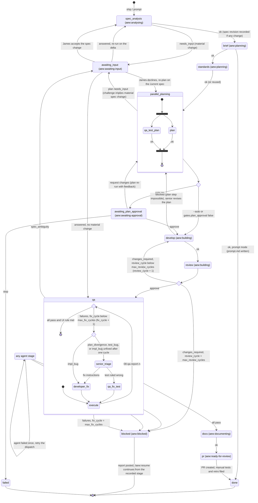

# Run state machine

`state.json` holds `stage` (where the run is) and `status` (how it is doing). Only
`scripts/state.sh` writes it, and each transition appends one line to `log.md` and one entry to
`history`. The diagram shows stages as states. Statuses other than `running` appear as their
own states. `parallel_planning` is the `qa_test_plan` ∥ `plan` step: both run at once, `stage`
reads `plan`, and the label is `aew:planning`. Inside `qa` (label `aew:testing`) the fix loop
keeps `stage` at `qa`.

## Gates

| Gate | When | Options | Skippable |
|---|---|---|---|
| Material spec change | `spec_analysis` or `plan` returns `needs_input` | AskUserQuestion with recommended answers | Never, even with `--auto` |
| Spec ambiguity | QA failure classed `spec_ambiguity` | AskUserQuestion with recommended answers | Never |
| Plan approval | `qa_test_plan` and `plan` both `ok` | approve / request changes / stop (plan summary of 25 lines or fewer, plus the file path) | `--auto` or `gates.plan_approval: false` |
| Irreversible or destructive operation | Any stage | confirm / cancel | Never |

An answer that confirms a material change is recorded first: a `spec-revision-v<N>.md` comment,
the issue body revision, `aew:spec-revised`, and `spec_revision + 1`. Then spec analysis re-runs
on the delta, and the stages after it run again.

## Failure paths

| Trigger | Result |
|---|---|
| Agent returns `failed` | Retry the same dispatch once. A second `failed` sets `blocked`. |
| Agent returns `blocked` | The orchestrator routes it: developer → senior-engineer (plan revision); anything else → `blocked`. |
| `changes_required` once `review_cycle` = `max_review_cycles` | `blocked` |
| QA failures once `fix_cycle` = `max_fix_cycles` | `blocked` |
| UI brief with an automatable UI test still failing | Not done. It counts as a QA failure. |
| James chooses stop at a gate | `failed` (terminal) |
| SubagentStop gate hook blocks (artefact or return block missing) | The agent continues until the artefact is valid. Claude Code overrides the hook after eight consecutive blocks; the return is then checked as usual, and a missing artefact or return block counts as `failed`. |

On `blocked`, the orchestrator posts a report comment with `gh-issue.sh comment`, sets
`aew:blocked` and stops. `resume` re-checks the branch and working tree, then continues from the
recorded `stage`.

## Counters

- `review_cycle` starts at 0 and goes up by one on each `changes_required`. The next review file is `07-review-<review_cycle + 1>.md`.
- `fix_cycle` starts at 0 and goes up by one on each failing QA pass that is routed to a fix. The next QA report is `08-qa-report-<fix_cycle + 1>.md`, and its triage is `09-triage-<same n>.md`.
- `spec_revision` starts at 1 (the author's original) and goes up by one on each recorded revision.
