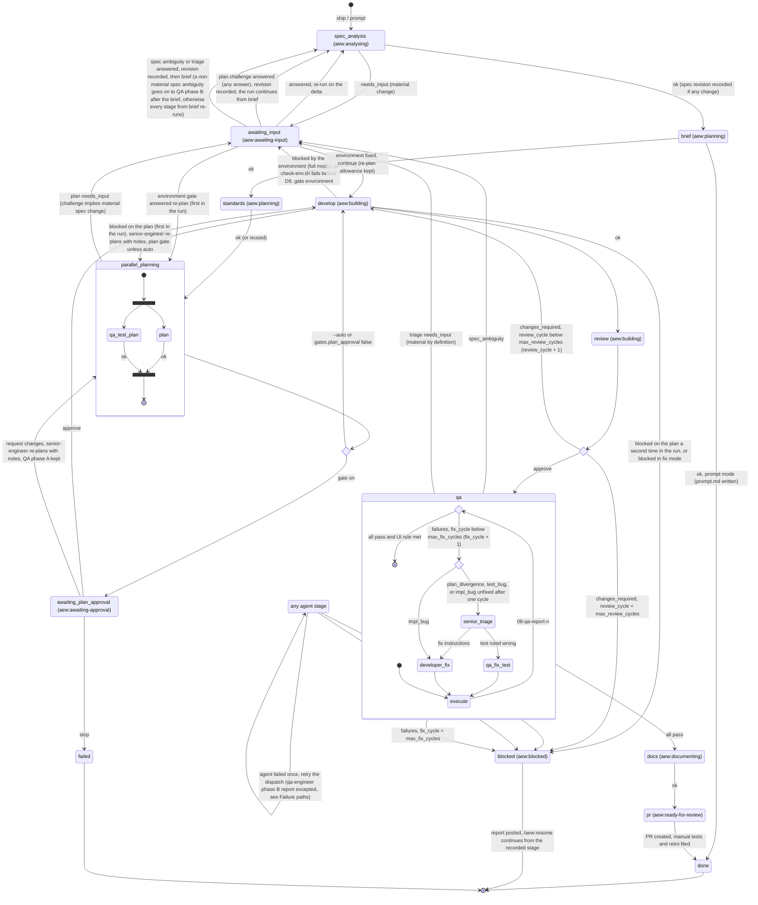

# Run state machine

`state.json` holds `stage` (where the run is) and `status` (how it is doing). Only
`scripts/state.sh` writes it, and each transition appends one line to `log.md` and one entry to
`history`. The diagram shows stages as states. Statuses other than `running` appear as their
own states. `parallel_planning` is the `qa_test_plan` ∥ `plan` step: both run at once, `stage`
reads `plan`, and the label is `aew:planning`. Inside `qa` (label `aew:testing`) the fix loop
keeps `stage` at `qa`.



## Gates

| Gate | When | Options | Skippable |
|---|---|---|---|
| Material spec change | `spec_analysis` or `plan` returns `needs_input` | AskUserQuestion with recommended answers | Never, even with `--auto` |
| Spec ambiguity | QA failure classed `spec_ambiguity` | AskUserQuestion with recommended answers | Never |
| Plan approval | `qa_test_plan` and `plan` both `ok` | approve / request changes / stop (plan summary of 25 lines or fewer, plus the file path) | `--auto` or `gates.plan_approval: false` |
| Irreversible or destructive operation | Any stage | confirm / cancel | Never |

The answers go to spec-analyser first. When it returns `ok` with changes in `spec-changes.json`, the
revision is recorded before the next stage: a `spec-revision-v<N>.md` comment, the issue body
revision, `aew:spec-revised`, and `spec_revision + 1`. The stages after it then run again.

**Unanswered gate.** If AskUserQuestion is unavailable (headless with `--permission-prompts none`),
refused or empty, the gate stays pending (`gate:<id> <file>` note in `history`); ship prints the
questions or plan summary and `Answer with /aew:resume <id>`, and stops. `/aew:resume` re-asks it.

## Failure paths

| Trigger | Result |
|---|---|
| Agent returns `failed` (any case other than the next row) | Retry the same dispatch once. A second `failed` sets `blocked`. |
| qa-engineer phase B returns `failed` with a complete report | "QA failures, report complete": route by triage class (the `qa` state above), counted against `max_fix_cycles`. Not retried. |
| Agent returns `blocked` | Developer in full mode → senior-engineer plan revision with `notes`, once per run (a second full-mode `blocked` → `blocked`); developer in fix mode (review or QA fix) → `blocked`; anything else → `blocked`. |
| `changes_required` once `review_cycle` = `max_review_cycles` | `blocked` |
| QA failures once `fix_cycle` = `max_fix_cycles` | `blocked` |
| UI brief with an automatable UI test still failing | Not done. It counts as a QA failure. |
| James chooses stop at a gate | `failed` (terminal) |
| SubagentStop gate hook blocks (artefact or return block missing) | The gate blocks once, and its reason becomes the agent's next instruction. If the agent stops again (`stop_hook_active` true), the gate allows the stop. The return is then checked as usual: a missing or invalid artefact or return block counts as `failed` (retry once, then `blocked`). |

qa-engineer phase B returns `failed` when its report is complete but tests or serious or critical accessibility checks failed. That `failed` means "QA failures, report complete": the orchestrator routes it by triage class under `limits.max_fix_cycles` and does not retry it. It counts as such only when `08-qa-report-<n>.md` exists, ends with a valid return block whose STATUS is `failed`, and the triage table at the top of its `## Failures` section has at least one `TC-<n>` row. Anything else is an ordinary agent `failed`: retry once, then `blocked`.

Mechanical test (the orchestrator implements it in prompt 05; the smoke checks use it), with `valid_return_block` as defined in `scripts/hooks/gate-subagent.sh`:

```sh
qa_failures_complete() {   # qa_failures_complete <report>; exit 0 = QA failures, report complete
  [ -f "$1" ] && [ "$(valid_return_block "$1")" = failed ] &&
    awk '/^## /{f=($0=="## Failures")} f && /^\|[[:space:]]*TC-[0-9]+[[:space:]]*\|/{n++} END{exit !(n>0)}' "$1"
}
```

On `blocked`, the orchestrator posts a report comment with `gh-issue.sh comment`, sets
`aew:blocked` and stops. `resume` re-checks the branch and working tree, then continues from the
recorded `stage`.

## Counters

- `review_cycle` starts at 0 and goes up by one on each `changes_required`. The next review file is `07-review-<review_cycle + 1>.md`.
- `fix_cycle` starts at 0 and goes up by one on each failing QA pass that is routed to a fix. The next QA report is `08-qa-report-<fix_cycle + 1>.md`, and its triage is `09-triage-<same n>.md`.
- `spec_revision` starts at 1 (the author's original) and goes up by one on each recorded revision.
